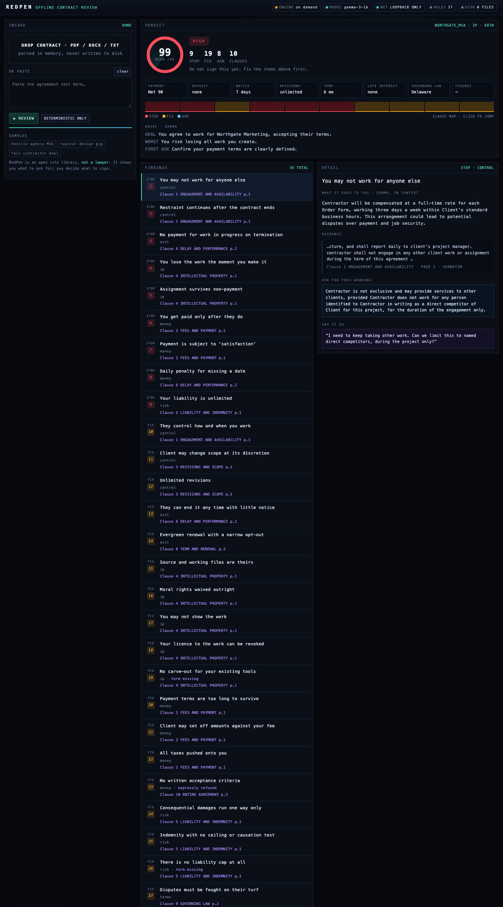
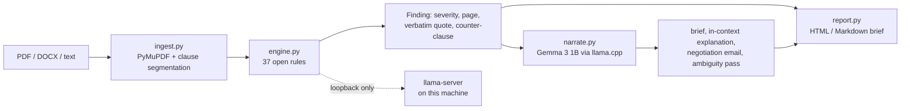

# RedPen

**Offline contract review for freelancers.** Drop in a client agreement, get the
clauses that routinely cost you money or time, the exact words that triggered
each one, the wording to ask for, and a negotiation email you can send.

Runs entirely on your laptop. Open-weight model, open rule library, no account,
no API key, no upload. A client's NDA never touches a server you don't control,
because it never leaves the machine.



> RedPen is a pattern-matching tool, **not a lawyer**. It tells you what to ask
> for. For anything you'd bet a month of income on, buy an hour of a real
> lawyer's time in your own jurisdiction.

---

## Install

```bash
curl -fsSL https://raw.githubusercontent.com/soumwadeep/RedPen/main/install.sh | bash
```

Or, if you prefer to see what it does first:

```bash
git clone https://github.com/soumwadeep/RedPen.git && cd RedPen
brew install llama.cpp          # the inference engine
pip install -e .
redpen models --download gemma-3-1b
redpen doctor                   # verifies this machine
redpen                          # opens http://127.0.0.1:8790
```

Requirements: macOS or Linux, Python 3.10+, 8 GB RAM, ~1 GB free disk for the
weights. No GPU. No internet after the first download.

## Use

```bash
redpen review contract.pdf            # local model explains each finding
redpen review contract.pdf --no-llm   # deterministic pass only, instant
redpen review contract.pdf --html brief.html
redpen                                # the app: drop a file, read it in a browser
```

The app binds `127.0.0.1` and opens in your browser. You can drop a PDF, upload
a DOCX, or paste text from an email.

## How it works

Two layers, deliberately separated.



**The rules decide what is dangerous.** `redpen/rules/` is 65 rules in plain Python across three libraries covering IP assignment, payment terms, liability, scope control and
exit. Each carries its own plain-English explanation, a counter-clause you can
paste, and the sentence to say in the email. Every finding cites the clause, the
page, and the verbatim words that fired — so you can check the tool's work
against the document.

**The model does language, never judgement.** Gemma 3 1B reads what the rules
already found and writes it in the context of *this* contract: a three-line
brief, a per-finding explanation, a negotiation email, and one pass at vagueness
the patterns cannot see ("Schedule A is undefined", "promptly is not defined").

This split exists because a 1B model is not reliable enough to decide whether a
clause is dangerous, and a rules engine is not good enough to write the email.
Each layer does the half it is actually competent at.

## The guard-rails

Small models fail in ways that would embarrass you in front of a client, so the
output is validated rather than trusted:

| Failure | Guard |
| --- | --- |
| Cites a clause that doesn't exist | every citation resolved against real clauses, otherwise dropped |
| Drops three of your six asks | coverage check against the suggested wording before the email is shown |
| Signs your email "Max" | signature stripped, replaced with `[your name]` |
| Says "Here's a three-line explanation:" | preamble peeled |
| Refuses to match the requested format | format accepted loosely (bullets, prose, numbers); content checked strictly |
| Engine not running / model returns junk | deterministic fallback for every role; the report is always complete |
| Mislabels which model wrote it | source label reads the model that actually ran |

## Document types

RedPen classifies what it is reading and runs only the rules that make sense for it.
An unscoped library will tell an intern they are missing a deposit clause and a
late-payment interest rate -- true, worthless, and printed next to the real
finding about their original certificates sitting in the employer's drawer.

| Type | Detected from | Example findings |
| --- | --- | --- |
| **Services agreement** | contractor, SOW, invoice, milestones | pay-when-paid, Net 90, IP on creation |
| **Offer letter / internship** | intern, stipend, appointment, notice period | unpaid trial days, certificates withheld, one-way notice |
| **NDA** | confidential information, receiving party | indemnity hidden in clause 9, confidentiality that never ends |
| **Not an agreement** | none of the above | refused: "an instruction list makes no promises" |

Separately, unfilled fields -- `[Amount]`, `[city, state]`, `___% advance` -- are
counted and shown as their own panel, and any finding whose trigger text is still
a blank is demoted. A draft you have not finished is not a deal working against you.

## Adding your own rules

The library is the product. If you edit video, "perpetual, all-media,
universe-wide usage rights" is a red flag that no general model will reliably
flag *and* you cannot make an API see it. Add it:

`~/.redpen/rules/video.json`

```json
[{
  "id": "all-media-perpetual-usage",
  "title": "Usage rights are unlimited",
  "category": "ip",
  "severity": 3,
  "why": "A perpetual all-media licence is a different price than a 12-month single-platform run.",
  "fix": "Usage is limited to one platform for 12 months; further usage is priced per the rate card.",
  "ask": "Which platforms, and for how long? That changes the fee.",
  "any_of": ["all media", "any media now known or hereafter devised", "perpetual licen"],
  "all_of": [["usage", "licen", "rights"]]
}]
```

No code, no restart of anything else, no one's approval. Patterns are matched
case-insensitively against normalised text; `contractor` and `client` inside a
pattern automatically expand to the synonyms real agreements use (Designer,
Supplier, Service Provider, Party B / Company, Customer, Purchaser).

## Swapping the model

```bash
redpen models --use qwen-2.5-1.5b
```

Same rules, same findings, different wording. Verified on an 8 GB laptop:
reviewing the same contract under Gemma 3 1B and Qwen 2.5 1.5B produced
identical findings — only the brief and the email changed. It also works with
LM Studio or Ollama: point `REDPEN_BASE_URL` at their loopback `/v1`.

## Privacy, verified

`scripts/offline_proof.sh` runs a full review — parse, rules, and the entire
model pass — while sampling every socket the process holds:

```
· sockets observed during the run:
    19876 127.0.0.1:52704->127.0.0.1:8777
    19876 127.0.0.1:8795
    7599  127.0.0.1:8777->127.0.0.1:52704
✓ PASS -- every socket was loopback. Review score 99/99, no request left the machine.
```

Enforced in code, not by policy:

- `LocalLLM` raises `NotLocal` for any base URL that is not loopback, so a stray
  environment variable cannot turn this into an uploader. There is a test for it.
- Uploads are parsed from bytes in memory and never written to disk.
- The last 8 reviews live in a bounded in-memory cache; nothing is persisted.
- `web/index.html` and the exported brief contain no remote `src` or `href` —
  a test fails the build if one appears.
- No account, no telemetry, no analytics script.

For the strongest version: turn Wi-Fi off and run `redpen review contract.pdf`.

## Why local-first, in numbers

| | RedPen | A hosted API |
| --- | --- | --- |
| Cost per review | 0 | token-metered, and contracts are long |
| Works on a plane | yes | no |
| Client documents on someone else's server | never | by definition |
| Marginal cost of user #500 | 0 | scales with usage |
| Can be priced as a one-time purchase | yes | very hard |

That last row is the business reason. At ~$19 one-time, a hosted-API product
gives away its margin to whoever reviews the most contracts. Running the model
locally means the heaviest user costs nothing extra, which is what makes a
one-time price survivable for an indie tool.

## Limits, honestly

- **8 GB RAM is the floor.** 1B models at Q4 fit; 7B does not. Close Chrome.
- **Scanned PDFs are not supported.** There is no selectable text to read, and
  RedPen will not send your pages to an OCR service. It says so rather than
  returning an empty review.
- **The model layer is a 1B model.** Its explanations are sometimes generic.
  That is why the library's own wording is always available underneath, and why
  findings never depend on the model.
- **A clean report is weak evidence.** No rule matched; that is not a guarantee
  the contract is fair. The UI says this out loud.
- **Jurisdictions differ.** Unenforceable in one country is standard in another.
  The rules flag commercial risk patterns, not legal validity.

## Tests

```bash
python3 -m pytest -q            # 98 tests, no model needed
python3 -m pytest -q -m slow    # adds a real local-model pass
```

The suite asserts recall (36 traps in a hostile MSA, 19 in an internship offer
letter, 11 in a one-way NDA), precision (zero false positives on a fair contract), negation handling ("payment is **not** contingent
on receipt of funds" must not fire), role synonyms, page grounding through a PDF
round-trip, and that every quoted piece of evidence exists verbatim in the
source document.

## Layout

```
redpen/
  ingest.py       PDF/DOCX/text -> clauses with page + span grounding
  rules/catalog.py    freelance / B2B red flags
  rules/employment.py offer letters and internships
  rules/nda.py        confidentiality agreements
  doctype.py          document typing and unfilled-field detection
  engine.py       matching, negation, evidence, deal-shape extraction, scoring
  llm.py          loopback-only OpenAI-compatible client + small-model hygiene
  narrate.py      brief, explanations, negotiation email, ambiguity pass
  report.py       terminal, Markdown, self-contained HTML brief
  server.py       FastAPI on 127.0.0.1, in-memory cache
  cli.py          redpen review | serve | models | rules | doctor
web/index.html    the app
samples/          three synthetic contracts: hostile, typical, fair
scripts/offline_proof.sh
```

## License

MIT. Model weights under the [Gemma Terms of Use](https://ai.google.dev/gemma/terms)
/ Qwen licence respectively — RedPen ships no weights, it downloads them for you.
